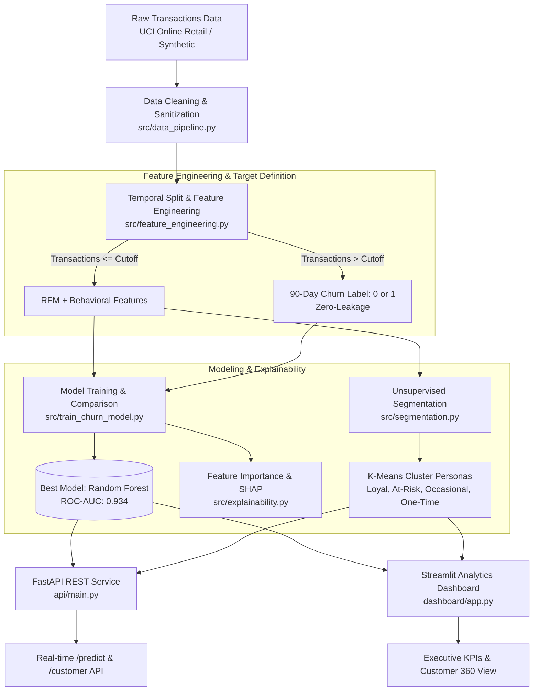
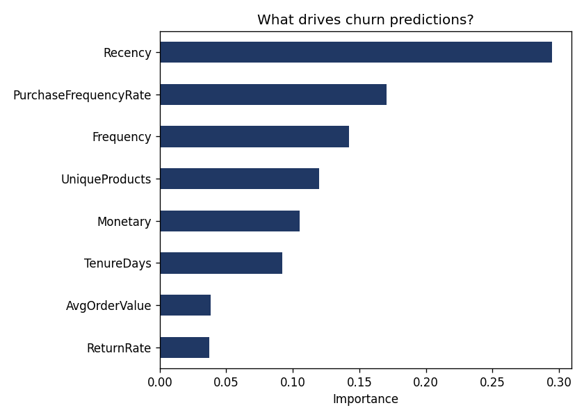

# 📊 Customer Behavior Prediction & Segmentation Platform

[](https://www.python.org/)
[](https://fastapi.tiangolo.com/)
[](https://streamlit.io/)
[](https://scikit-learn.org/)
[](https://www.docker.com/)
[](https://opensource.org/licenses/MIT)

An end-to-end Machine Learning and Business Intelligence platform that transforms raw retail transaction records into actionable retention strategies. The platform predicts customer churn risk, identifies behavioral segments using unsupervised clustering, interprets feature drivers via SHAP, and serves insights through a high-performance **FastAPI microservice** and an interactive **Streamlit executive dashboard**.

---

## 📑 Table of Contents

- [Overview & Architecture](#-overview--architecture)
- [Key Features](#-key-features)
- [Machine Learning Workflow](#-machine-learning-workflow)
  - [1. Data Cleaning & Preprocessing](#1-data-cleaning--preprocessing)
  - [2. Leakage-Free Target & Feature Engineering](#2-leakage-free-target--feature-engineering)
  - [3. Churn Model Comparison & Benchmarks](#3-churn-model-comparison--benchmarks)
  - [4. Customer Behavioral Segmentation](#4-customer-behavioral-segmentation)
  - [5. Model Explainability & SHAP Analysis](#5-model-explainability--shap-analysis)
- [API Reference (FastAPI)](#-api-reference-fastapi)
- [Interactive Dashboard (Streamlit)](#-interactive-dashboard-streamlit)
- [Project Structure](#-project-structure)
- [Getting Started](#-getting-started)
  - [Prerequisites](#prerequisites)
  - [Local Installation](#local-installation)
  - [Running the Complete Pipeline](#running-the-complete-pipeline)
  - [Using the Real UCI Online Retail II Dataset](#using-the-real-uci-online-retail-ii-dataset)
- [Docker Deployment](#-docker-deployment)
- [Business Impact & Viva / Interview Highlights](#-business-impact--viva--interview-highlights)

---

## 🏛 Overview & Architecture

Retaining existing customers is significantly more cost-effective than acquiring new ones. This platform provides an end-to-end solution: from ingesting noisy, raw e-commerce transaction data to serving real-time churn predictions with actionable customer persona segmentation.



---

## ✨ Key Features

- **🛡️ Leakage-Free Target Formulation**: Features are calculated strictly on transactions before an observation cutoff date, while churn is evaluated over a subsequent 90-day evaluation window.
- **⚖️ Imbalanced-Aware Evaluation**: Evaluated using Precision, Recall, F1-Score, and ROC-AUC rather than raw accuracy, ensuring the model identifies true churners without false comfort.
- **🏆 Multi-Model Benchmark**: Automated comparison across Logistic Regression, Random Forest, and Gradient Boosting / XGBoost, persisting the best model by ROC-AUC.
- **🎯 Persona-Based Customer Segmentation**: Translates raw K-Means clusters into actionable marketing personas (Loyal High-Value, Lapsed / At Risk, Occasional Shoppers, One-Time Buyers).
- **🔍 Explainable AI**: Global feature importance and SHAP-ready integration to understand the primary behavioral drivers of churn.
- **⚡ Production-Ready REST API**: FastAPI backend with Pydantic validation, health probes, batch/single lookups, and Swagger UI documentation.
- **📊 Executive Dashboard**: 3-tier Streamlit dashboard featuring portfolio overview, high-risk customer tables, single-customer deep dives, and segment metrics.
- **🐳 Containerized**: Dockerized microservice ready for container orchestration (Kubernetes, AWS ECS, GCP Cloud Run).

---

## 🔬 Machine Learning Workflow

### 1. Data Cleaning & Preprocessing
Handled in [`src/data_pipeline.py`](src/data_pipeline.py):
- Drops records lacking valid `CustomerID`.
- Removes administrative noise and operational artifacts (e.g., `POST`, `DOT`, `BANK CHARGES`, `AMAZONFEE`, `M`).
- Automatically tags return transactions (`Quantity < 0`) for return-rate calculations.
- Enforces data integrity checks (`UnitPrice > 0`) and computes item-level transaction values (`TotalPrice = Quantity * UnitPrice`).

### 2. Leakage-Free Target & Feature Engineering
Handled in [`src/feature_engineering.py`](src/feature_engineering.py):
A common pitfall in customer churn modeling is *data leakage*—using future signals to predict the past. This platform enforces strict temporal separation:
- **Observation Period ($\le T_{cutoff}$)**: Historical transactions used to engineer customer behavioral signals.
- **Prediction Window ($T_{cutoff} \text{ to } T_{cutoff} + 90 \text{ days}$)**: Customers who do **not** return within this window are labeled as `Churned = 1`.

#### Engineered Feature Schema:
| Feature | Description | Business Significance |
| :--- | :--- | :--- |
| **`Recency`** | Days elapsed since the customer's last purchase before cutoff | Strongest single predictor of churn risk |
| **`Frequency`** | Total distinct orders / invoices placed | Indicates engagement and platform stickiness |
| **`Monetary`** | Net historical spending across all orders | Reflects Customer Lifetime Value (CLV) |
| **`AvgOrderValue`** | Average basket spend per order | Differentiates bulk purchasers from budget shoppers |
| **`TenureDays`** | Days between customer's first and last order before cutoff | Distinguishes newly acquired users from established accounts |
| **`UniqueProducts`** | Number of distinct product SKUs purchased | Measures product breadth and catalog engagement |
| **`ReturnRate`** | Proportion of negative-quantity transactions | High returns correlate with customer dissatisfaction |
| **`PurchaseFrequencyRate`** | Normalized orders placed per 30-day window | Measures velocity of repeat transactions |

---

### 3. Churn Model Comparison & Benchmarks
Handled in [`src/train_churn_model.py`](src/train_churn_model.py):
Models are trained with stratified 80/20 train-test splits and evaluated against class imbalance using balanced sample weights.

#### Benchmark Results:
| Model Architecture | Precision | Recall | F1-Score | ROC-AUC | Status |
| :--- | :---: | :---: | :---: | :---: | :---: |
| **Random Forest Classifier** | **0.918** | **0.939** | **0.929** | **0.934** | 🏆 **Selected Best Model** |
| **Logistic Regression** (Standardized) | 0.974 | 0.817 | 0.888 | 0.932 | Baseline |
| **Gradient Boosting** (sklearn / XGBoost) | 0.904 | 0.939 | 0.921 | 0.927 | Alternative |

> *The Random Forest model achieves the optimal trade-off between Recall (0.939) and Precision (0.918), capturing over 93% of at-risk customers while keeping false alarm rates low.*

---

### 4. Customer Behavioral Segmentation
Handled in [`src/segmentation.py`](src/segmentation.py):
Using unsupervised **K-Means clustering** on standardized RFM features, customers are categorized into 4 strategic tiers:

| Persona Segment | Behavioral Profile | Strategic Recommended Action |
| :--- | :--- | :--- |
| 🌟 **Loyal High-Value** | High Frequency, High Monetary, Low Recency | VIP perks, exclusive previews, loyalty rewards |
| ⚠️ **Lapsed / At Risk** | High Recency (inactive), moderate past spend | Win-back discount campaigns, re-engagement surveys |
| 🛒 **Occasional Shopper** | Moderate Recency, Moderate Spend, Multiple Orders | Personalized cross-sell / upsell recommendations |
| 👤 **One-Time Buyer** | Frequency = 1, varied recency | Welcome discount on 2nd purchase, onboarding drip |

---

### 5. Model Explainability & SHAP Analysis
Handled in [`src/explainability.py`](src/explainability.py):
- **Global Feature Importance**: Evaluates which attributes carry the highest information gain across ensemble trees (`Recency`, `PurchaseFrequencyRate`, and `Monetary` consistently rank top).
- **SHAP (SHapley Additive exPlanations)**: TreeExplainer integration providing granular, per-customer attribution values explaining *why* an individual customer was flagged as high-risk.



---

## 🔌 API Reference (FastAPI)

The REST API serves real-time churn probabilities and classification tiers.

### Start the API Server
```bash
uvicorn api.main:app --reload --host 127.0.0.1 --port 8000
```
Interactive documentation is available at `http://127.0.0.1:8000/docs`.

### Key Endpoints

#### 1. Real-time Inference (`POST /predict`)
Evaluates churn risk for an arbitrary feature vector.

**Request Payload:**
```json
{
  "Recency": 120.0,
  "Frequency": 2.0,
  "Monetary": 350.0,
  "AvgOrderValue": 175.0,
  "TenureDays": 180.0,
  "UniqueProducts": 5.0,
  "ReturnRate": 0.05,
  "PurchaseFrequencyRate": 0.33
}
```

**Response (`200 OK`):**
```json
{
  "churn_probability": 0.8421,
  "will_churn": true,
  "risk_level": "High Risk"
}
```

#### 2. Customer Lookup by ID (`GET /customer/{customer_id}`)
Retrieves historical pre-computed features and outputs live model inference for an existing customer.

**Example Request:**
```bash
curl -X GET "http://127.0.0.1:8000/customer/12347"
```

---

## 🖥 Interactive Dashboard (Streamlit)

Launch the dashboard with:
```bash
streamlit run dashboard/app.py
```

### Dashboard Tabs:
1. **Executive Overview**: Total customer base, predicted portfolio churn rate, average customer spend, churn probability distribution histogram, and top 10 highest-risk accounts.
2. **Customer Lookup**: Single-customer 360° view with instant KPIs (churn probability gauge, recency, total orders, lifetime spend, unique products).
3. **Segments Explorer**: Visualizes customer cluster distribution bar chart and RFM profile comparison tables.

---

## 📁 Project Structure

```
Customer-Behavior-Prediction-Platform/
├── api/
│   └── main.py                     # FastAPI backend microservice
├── dashboard/
│   └── app.py                      # Streamlit interactive BI dashboard
├── data/
│   ├── generate_synthetic_data.py  # Zero-dependency synthetic generator
│   ├── raw_transactions.csv        # Raw transaction log (generated or UCI)
│   ├── clean_transactions.csv      # Cleaned and validated transactions
│   ├── customer_features.csv       # RFM+ behavioral features with churn label
│   └── customer_segments.csv       # Segmented customer profiles
├── models/
│   ├── best_model_name.pkl         # Stored identifier of highest ROC-AUC model
│   ├── churn_model.pkl             # Serialized production classifier
│   ├── feature_cols.pkl            # Feature column alignment artifact
│   ├── feature_importance.png      # Feature importance visual artifact
│   ├── kmeans_model.pkl            # Trained K-Means segmentation model
│   ├── model_comparison.csv        # Precision/Recall/F1/ROC-AUC benchmark table
│   ├── scaler.pkl                  # StandardScaler fitted on training features
│   └── segment_scaler.pkl          # Scaler for RFM segmentation
├── src/
│   ├── data_pipeline.py            # Step 1: Data cleaning & sanitization
│   ├── feature_engineering.py      # Step 2: Temporal split & RFM feature creation
│   ├── train_churn_model.py        # Step 3: Model training, evaluation & tuning
│   ├── segmentation.py             # Step 4: K-Means clustering & persona tagging
│   └── explainability.py           # Step 5: Feature importance & SHAP explainers
├── .gitignore                      # Git exclusion rules
├── Dockerfile                      # Production container recipe
├── requirements.txt                # Project dependencies
└── README.md                       # Comprehensive platform documentation
```

---

## 🚀 Getting Started

### Prerequisites
- Python 3.10, 3.11, or 3.12
- Git
- (Optional) Docker

### Local Installation

1. **Clone the repository:**
   ```bash
   git clone https://github.com/ashwin0657/Customer-Behavior-Prediction-Platform.git
   cd Customer-Behavior-Prediction-Platform
   ```

2. **Create and activate a virtual environment:**
   ```bash
   # Windows (PowerShell)
   python -m venv venv
   .\venv\Scripts\Activate.ps1

   # Linux / macOS
   python3 -m venv venv
   source venv/bin/activate
   ```

3. **Install dependencies:**
   ```bash
   pip install -r requirements.txt
   ```

### Running the Complete Pipeline

Execute each pipeline step in sequence:

```bash
# 1. Generate sample data (or fetch UCI dataset below)
python data/generate_synthetic_data.py

# 2. Clean and preprocess transaction data
python src/data_pipeline.py

# 3. Engineer RFM features & create leakage-free churn labels
python src/feature_engineering.py

# 4. Train, compare models, and save the best classifier
python src/train_churn_model.py

# 5. Perform customer segmentation (K-Means)
python src/segmentation.py

# 6. Generate explainability plots
python src/explainability.py
```

### Using the Real UCI Online Retail II Dataset

To run the pipeline on the official **UCI Online Retail II** dataset:
```bash
pip install ucimlrepo
python -c "
from ucimlrepo import fetch_ucirepo
data = fetch_ucirepo(id=502)
df = data.data.features
df.to_csv('data/raw_transactions.csv', index=False)
print('Downloaded UCI Online Retail II dataset successfully.')
"
```
Once downloaded, re-run `python src/data_pipeline.py` through `python src/explainability.py`—all column schemas match seamlessly.

---

## 🐳 Docker Deployment

Build and run the FastAPI service in an isolated Docker container:

```bash
# Build the Docker image
docker build -t churn-prediction-api .

# Run container on port 8000
docker run -d -p 8000:8000 --name churn-api-container churn-prediction-api

# Check container logs
docker logs -f churn-api-container
```
Verify the deployment by navigating to `http://localhost:8000/docs`.

---

## 💡 Business Impact & Viva / Interview Highlights

When presenting this project or discussing it in technical interviews:

1. **Why not just measure Accuracy?**
   - Churn datasets suffer from severe class imbalance. A dummy classifier predicting `0` for every user could achieve 85%+ accuracy while missing 100% of churners. We prioritize **ROC-AUC (0.934)** and **Recall (0.939)** to ensure genuine at-risk accounts are identified.
2. **How is Data Leakage Prevented?**
   - Features (RFM, tenure, return rate) are computed solely from data strictly on or before a defined cutoff timestamp. The target label is derived strictly from the subsequent 90-day window.
3. **From Clusters to Business Action**:
   - Rather than handing non-technical stakeholders raw cluster IDs (e.g., "Cluster 3"), we map mathematical clusters into human-understandable business personas with concrete retention plays.
4. **Explainability Over Black Boxes**:
   - Model outputs are paired with feature importance and SHAP analysis so account managers understand *why* a customer is flagged (e.g., increasing recency + falling order velocity).

---

## 📄 License

This project is licensed under the [MIT License](LICENSE).
